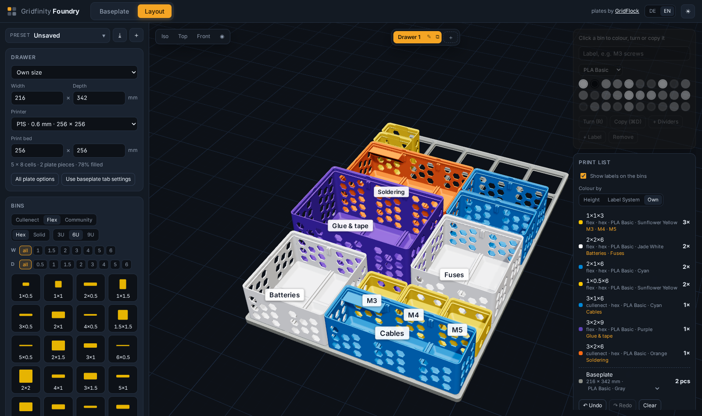
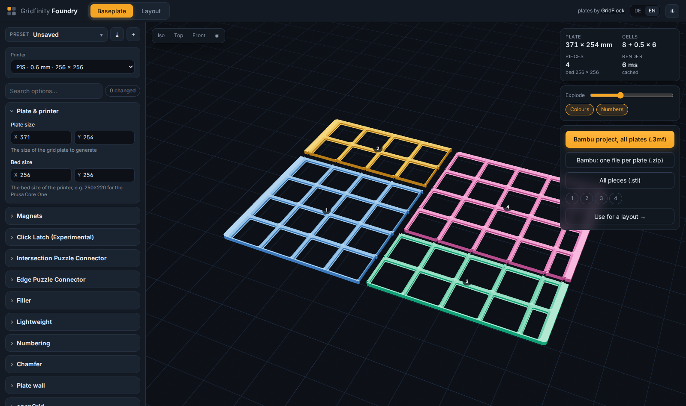

# Gridfinity Foundry

Plan a drawer full of Gridfinity bins in your browser: generate the baseplate, split it for your print bed, drop bins
onto it, and download everything as STL files or as a Bambu Studio project with the build plates already laid out.



## What it does

- **Baseplates** with every option of [GridFlock](https://github.com/yawkat/gridflock) (magnets, puzzle connectors,
  fillers, walls, screws, lightweight mode, …), rendered live by native OpenSCAD. The plate is split into pieces that fit
  your print bed; explode them, see each piece's size, download all pieces or one.
- **Layout**: enter your drawer size and pick your printer, then click or drag bins from the library onto the plate. Bins
  snap to the 42 mm grid (half-cell bins to half cells), never overlap, and can be turned, moved, copied, coloured and labelled ("M3 screws"; the label shows on the bin and in the print list)
  (Bambu Lab filament colours, PLA Basic/Matte, PETG). Undo and redo, keyboard shortcuts, camera views.
- **Drawer planner**: a project holds several drawers, each with its own size and layout (tabs above the 3D view).
  Common furniture is built in (IKEA ALEX with 5 or 9 drawers, HELMER, MALM 80) and sets the inner size, or all its
  drawers at once. The print list and the downloads cover one drawer or all of them, with a baseplate per drawer.
- **Fill gaps** fills every free spot of the drawer with the biggest bin of the chosen type and height that fits
  (up to a size you pick, e.g. 2×2); one undo takes them all back.
- **Examples**: an empty layout offers two example drawers (screws in an IKEA ALEX, electronics in a HELMER) to start
  from.
- **Drawer height**: give the drawer's inner height and bins that would stick out are framed in red (heights measured
  from the bins' meshes, standing in the baseplate).
- **Your own bins**: drop any Gridfinity STL onto the plate (or into the Community section). It is centred, measured
  against the grid and added to the library on the server with your name, for everyone using that installation.
- **Engraved labels**: every labelled flex bin gets its flex label with the text engraved (sized to fit), in the print
  list and in the downloads.
- **Dividers and labels** from the default library can be added to the print list (with "+ Dividers" / "+ Label" on a
  bin, or from the parts list).
- **Filament estimate**: grams per line of the print list and the total in grams and metres, from the solid volume of
  each part (infill makes the real amount somewhat lower).
- **Drawer map**: a printable top view of each drawer (A4, one page each) with every bin's label, to stick inside the
  cabinet.
- **Downloads**: a print list with counts and filaments; a zip of all STL files; a Bambu Studio project (.3mf) with every
  part packed onto build plates of your printer's size, one plate per colour, or one file per plate.
- **Printers**: every Bambu Lab printer and nozzle from Bambu Studio's profiles sets the bed size. A Bambu project needs
  a template of that printer's settings (see below); the P1S 0.6 mm one is included.
- **Share links**: "Share" copies a link that holds the whole project (baseplate, drawers, bins, labels, colours) in
  the URL itself; whoever opens it gets the project, without signing in and without anything stored on the server.
- **Presets** for plates and layouts, saved on the server. English and German. Light and dark theme.



## Run it

```
docker run -d -p 127.0.0.1:8742:8080 -v ./presets:/data/presets -v ./uploads:/data/uploads ghcr.io/dfox288/gridfinity-foundry
```

or from a checkout:

```
docker compose up -d --build                     # http://localhost:8742
```

Runs on Linux (amd64) and macOS (Apple Silicon). Settings in `compose.yaml`:

- `STUDIO_BIND=0.0.0.0` to open it to other machines on your network (it listens on localhost by default).
- On Linux, `STUDIO_UID=$(id -u) STUDIO_GID=$(id -g)` so the presets and uploads it writes belong to you.

Saved presets go to `presets/`, uploaded bins to `uploads/`.

A public installation in Germany needs an imprint and a privacy notice: put `imprint.de.md`, `imprint.en.md`,
`privacy.de.md` and `privacy.en.md` (Markdown) into `LEGAL_DIR` (default `/data/legal`); the app then links them in the
top bar and serves them at `/imprint` and `/privacy`. The fonts are bundled, so the app itself makes no requests to
third parties.

## The default library

The bins are made on demand: every size from 0.5 to 6 cells, 3 to 18 units high, hex and solid, in both label systems,
with dividers to match (`server/catalog.py`, about a second per bin the first time it is needed, then cached; set
`CACHE_MAX_MB`, default 2000). They are light Gridfinity bins (made with
[Gridfinity Extended](https://github.com/ostat/gridfinity_extended_openscad)) with two additions: divider ribs at the
joints between cells with a groove in the floor, so a loose divider slides in at every cell joint, and a honeycomb per
cell. Two label systems:

- **groove**: a groove all round the inside of the lip; a flex label springs into it when you want one, the bin stays
  stackable.
- **click**: a socket on a shelf in one corner for [Cullenect V2](https://makerworld.com/en/models/446624) click labels.

Dividers fit both. The labels in `library/labels/`: flex labels for the groove bins (fit 0.2), lip plugs (fit 0.6) and
glue labels for plain light bins, all tested; the corner labels with a tab divider are still being tested.

## Bambu Studio projects and printer templates

Bambu Studio only keeps the build plates of a project that carries printer settings, and it refuses settings that
were not written by Bambu Studio itself. So each printer needs a template: a project saved by Bambu Studio for that
printer. Its printer and process settings are kept; the filament settings are rebuilt for the colours of your layout.

To add a printer: in Bambu Studio select the printer, your process and filament, put any object on the plate, save the
project, and copy `Metadata/project_settings.config` out of the .3mf (it is a zip) to
`templates/<printer preset name>.json`, e.g. `templates/Bambu Lab A1 0.4 nozzle.json`. Printers without a template still
get the per-plate download, without settings.

## Development

- `server/`: plain Python (no packages): OpenSCAD renders, the library, presets, uploads, zip and 3MF export. The API is
  described at the top of `server/app.py`.
- `web/`: Vite, React, three.js (react-three-fiber, drei), zustand. `pnpm install && pnpm dev` against a server on :8742.
- The Docker build fetches GridFlock, Gridfinity Extended and Bambu Studio's printer profiles at pinned versions.
- Tests: `pnpm test` runs the unit tests (vitest, `src/**/*.test.ts`: placement, fill, grid, filament); the Docker
  build runs them too. `pnpm e2e` runs the browser checks in `e2e/` (Playwright) against a running app
  (`docker compose up -d --build`; `E2E_URL` for another address; `npx playwright install chromium` once).
- In the browser console, `studio` is the store and `foundryControls` the camera controls.

## Credits and licence

Gridfinity Foundry is GPL-3.0 (see `LICENSE`). It builds on:

- [Gridfinity](https://gridfinity.xyz) by Zack Freedman.
- [GridFlock](https://github.com/yawkat/gridflock) by Jonas Konrad (MIT / CC-BY 4.0), with
  [gridfinity-rebuilt-openscad](https://github.com/kennetek/gridfinity-rebuilt-openscad) (MIT): the baseplates.
- [Gridfinity Extended](https://github.com/ostat/gridfinity_extended_openscad) by ostat (GPL-3.0): the bins.
- [Cullenect labels](https://github.com/CullenJWebb/Cullenect-Labels) by Cullen J Webb (MIT): the label socket.
- [Bambu Studio](https://github.com/bambulab/BambuStudio) (AGPL-3.0): printer profiles and filament colours, read at
  build time.
